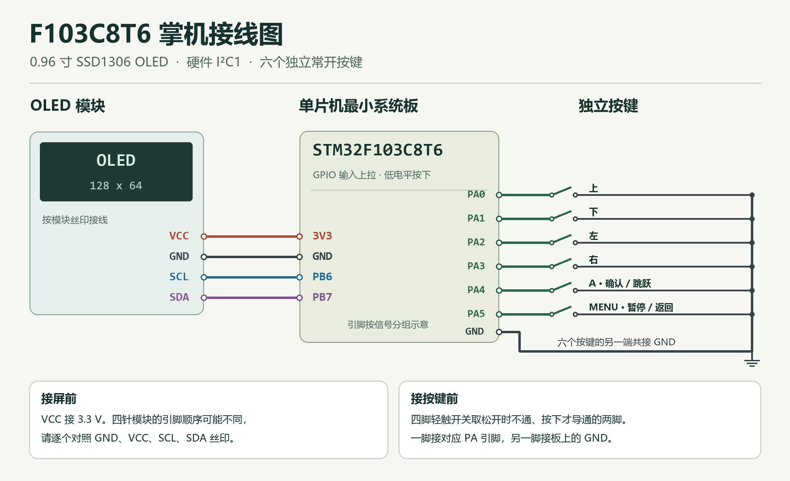

# OLED 三合一掌机

目标板为 STM32F103C8T6（LQFP48，64 KiB Flash、20 KiB SRAM）。同一份固件带有贪吃蛇、一键跳障碍和山顶邮局。按复位后先进入游戏库，方向键选中游戏，按 A 进入。屏幕菜单使用英文点阵字。

## 接线



参考板使用 **8 MHz 外部晶振**。OLED 按 **SSD1306、0.96 寸、128×64、四针 I²C 模块**配置。先按模块丝印辨认引脚。所有器件共地。

| 信号 | F103 接线 | 说明 |
| --- | --- | --- |
| OLED VCC / GND | 3V3 / GND | 参考模块由 3.3 V 供电 |
| OLED SCL / SDA | PB6 / PB7 | 硬件 I2C1 默认映射，400 kHz。确认总线上两线均已有到 3.3 V 的上拉，裸总线可各用约 4.7 kΩ，按线长和上升时间调整 |
| 上 / 下 / 左 / 右 | PA0 / PA1 / PA2 / PA3 | 每个常开按键一端接对应引脚，另一端接 GND，片内上拉 |
| A 确认 / 跳跃 | PA4 | 接法同方向键 |
| MENU 暂停 / 返回 | PA5 | 接法同方向键，使用 EXTI5 双边沿中断 |
| ST-LINK SWDIO / SWCLK | PA13 / PA14 | 共地，并按下载器要求连接目标电压参考 |

OLED 默认 7 位地址为 `0x3C`。若模块配置为 `0x3D`，修改 `BSP/oled.c` 的 `OLED_ADDR_7BIT`。传给 HAL 时驱动会左移一位。若实际模块为 SH1106，需适配初始化和显存寻址。

## 编译与运行

- **Keil**：打开 `MDK-ARM/oled_arcade.uvprojx`，使用 Arm Compiler 6，选择目标 `oled_arcade`，按 F7 编译。工程配置为 ST-LINK / SWD，可在目标板连接正确后下载。源码、启动文件和用到的 HAL/CMSIS 源文件都在工程内。
- **预编译固件**：`Firmware/oled_arcade.hex` 自带目标地址。使用 STM32CubeProgrammer 烧写同目录的 BIN 时，起始地址为 `0x08000000`。两份文件来自同一次 GCC Release 构建。
- **CubeMX**：打开根目录的 `oled_arcade.ioc` 可查看或修改所有外设配置。本工程的 IOC 默认生成 CMake。Keil 入口指向同一份 Core、Drivers 和游戏源码；增加外设源文件时同步加入 Keil 分组。CubeMX 重新生成时，应用的入口调用位于 main.c 的 USER CODE 区。
- **CMake**：准备 Ninja、CMake 3.22 及以上、Arm GNU Toolchain，把相应 bin 目录加入 PATH 后，在工程根目录运行：

```sh
cmake --preset Release
cmake --build --preset Release
```

输出在 `build/Release/`，包含 ELF、HEX、BIN 和链接映射文件。

## 如何玩

| 入口 | 操作与规则 |
| --- | --- |
| 游戏库 | 上下或左右选择。A 进入。游戏内短按并松开 MENU 暂停或继续，长按 MENU 约 0.7 秒返回游戏库 |
| SNAKE 贪吃蛇 | 上下切换经典/障碍，左右切换三档速度，A 开始；四方向转弯。每 5 个普通食物提速，出现 5 秒限时食物；普通食物加 1，限时食物加 5。撞墙、障碍或身体则结束，填满地图通关。分模式保留本次上电的最高分 |
| HURDLE RUN 一键跳障碍 | A 开始。角色自动前进，短按 A 或上键起跳。松开后再按才会触发下一次跳跃。越障加 1，逐步加速，碰撞后按 A 重开 |
| SUMMIT POST 山顶邮局 | A 出发，左右键走动和停步，A 或上键跳跃。依次走过河岸、石桥、山顶，过路标后失误可从路标复活。可从上方踩甲虫，三关共 9 枚邮票、初始 3 次机会。到达邮筒后按 A 去下一关 |

## 软件分层

| 目录 | 职责 |
| --- | --- |
| Core、Drivers | CubeMX 初始化和中断入口、STM32F1 HAL 和 CMSIS。HSE 8 MHz 经 PLL 得 72 MHz，APB1 为 36 MHz |
| BSP | 读取按键、时间戳消抖、SSD1306 初始化和 I2C 中断发送。游戏层不直接访问 GPIO 或 I2C |
| Display | 单色页缓冲区、裁剪、像素字体和图形。纯 C，可在桌面测试 |
| App | TIM2 毫秒节拍、事件派发、定步长游戏更新、刷屏调度、游戏库、公共暂停/返回 |
| Common、Games | 公共输入与游戏接口，以及三套独立游戏状态机、规则与画面 |
| Tests | 在电脑上用实际 C 游戏代码检查碰撞、通关、计分和暂停相关边界；用模拟 GPIO 验证按键 |

**时间与输入。** TIM2 输入 72 MHz，经 PSC=71、ARR=999 产生 1 ms 更新中断。中断只递增计数。主循环约每毫秒采样，原始电平持续稳定 18 ms 后才生成按下或松开事件。长按以时间戳判断。方向键持续按住供人物移动，跳跃只消费按下边沿。PA5 的外部中断仅记录最新电平。游戏逻辑固定每 8 ms 推进一步，约每 33 ms 提交一帧。主循环没有等待松手的循环或 HAL_Delay。

**显示。** 绘图、待发、在途缓冲区相互独立。SSD1306 采用横向寻址，整帧数据由 HAL_I2C_Master_Transmit_IT 异步发送。I2C1 的事件和错误中断驱动传输，完成回调只记录结果。屏幕忙时保留最新画面；NACK 或超时后状态机重新初始化并重试。刷屏时间取决于实际总线。

## 验证

已用 Keil Arm Compiler 6.24 和 Arm GNU 14.3.1 分别编译链接。GCC Release 链接映射的 Flash 占用为 18,100 B，RAM 区占用为 5,768 B（含链接脚本的堆栈预留）。

在电脑上用原生 C 编译器运行游戏和按键测试：

```sh
cmake -S Tests -B build/host-tests
cmake --build build/host-tests
ctest --test-dir build/host-tests --output-on-failure
```

三关路线测试通过按键逐步驱动真实游戏逻辑，可完成 3 次投递并取得全部邮票；另测失误后从路标复活。硬件验证需在实际板卡上确认 OLED 显示、I2C 地址及上拉、六键操作、晶振和下载。此次交付未进行实板烧录。
